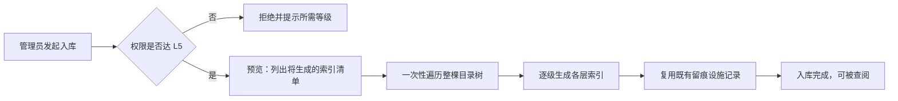
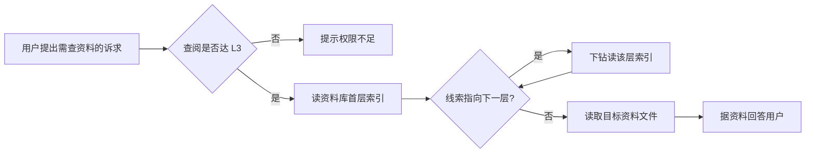
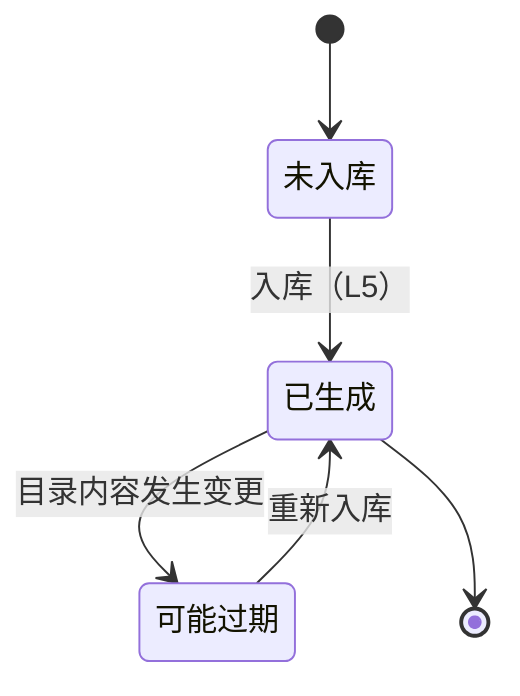

# 数字资产管理（资料库）— PRD（规格 / Spec）

> **日期**：2026-10-15
> **来源**：`Issues/数字资产管理.md`（多轮对话产出）
> **参与角色**：需求分析师、作为 Emily 开发者资深架构师、技术总监、信息架构师（自适应）、安全工程师（自适应）
> **宪法版本**：v1.2
> **阶段**：Specify（规格）——方案型技术设计见 `数字资产管理_计划_V1.md`

---

## 一、背景与目标

### 1.1 背景

Emily 在企业内网运行，员工会问大量"涉及查阅资料"的问题（某项目合同怎么约定、某类验收怎么做、上期周报说了什么）。当前这些原始资料（合同、周报、图纸、企业规范）以文件形式散落存放，Emily 只能依赖 RAG 向量检索"撞片段"：

- 向量检索**给不出结构**——它无法回答"这个资料库里有哪些目录、某个目录下有哪些文件"，只能命中零散片段；
- 资料之间**没有可读的导航**——人只能靠记忆或逐层翻目录去找文件；
- 因此 Emily 在需要"按线索逐级找资料"时**没有可用通道**。

业务侧已自发形成一种约定：每个资料文件夹放一份人写的索引文件，记录该文件夹简介、文件目录、每文件一句话描述。本需求要把这个约定**产品化**：把资料库独立存放，把索引生成固化为入库动作，并给 Emily 一条"先读索引、再逐级下钻文件"的查阅通道。

### 1.2 目标与成功指标

| 目标 | 成功指标（可度量） |
|------|------------------|
| 资料入库可规模化 | 任选一个含多层子目录的文件夹，一次入库即为其**每层目录**各生成一份索引文件，无需手工补写 |
| Emily 能按结构找资料 | 对"资料库里有哪些项目资料 / 某项目有哪些合同"类提问，Emily 能给出**目录制**回答（而非零散片段），且可下钻到具体文件 |
| 查阅受权可控 | 查阅行为在 L3 及以上可见、入库行为在 L5 及以上可用；越权时明确拒绝并说明所需等级 |
| 双通道不相扰 | 既有 RAG 检索行为无回归；资料库不被向量检索收录 |

### 1.3 非目标（明确不做）

1. **不替换、不改动既有 RAG 向量检索通道**——资料库是"结构化下钻"通道，与 RAG"语义检索"通道**并存**，本期不动 RAG；
2. **不做周期性自动重建索引**——系统当前不存在周期性自动触发机制；索引重建一律人工触发；
3. **不做资料库内文件的内容解析**——对图纸/压缩包/图片等不可解析类型，**不解析内容**，按文件名与所在文件夹名推断描述；不做 OCR/格式逆向；
4. **不做入库的分批/断点续入**——一次性遍历；首轮入库的耗时（大目录）可接受；
5. **不做控制台写操作**——展示板块只读，不提供入库/编辑/删除入口；
6. **不做资料库文件的额外外发限制**——L3 及以上用户允许获取（发送）资料库中的文件，本期不引入按文件粒度的"禁外发"管控（该能力属未来"文件外发管控"命题）；
7. **不因本需求修改内核文件**——Session 主循环与 LangGraph 执行引擎不在改动范围；
8. **不引入新依赖**。

---

## 二、需求登记表（核心章节）

### 2.1 用户故事与验收标准

#### 功能域 A：资料入库（增）

**US-01**｜角色：运维 / 管理员｜场景：把一份档案文件夹纳入资料库，希望它自带可逐级阅读的目录导航｜期望：系统为该文件夹的每一层目录各生成一份索引文件｜优先级：P0

| AC-ID | 验收标准（可判定） | 验证方式 |
|-------|------------------|---------|
| AC-US-01.1 | 指定一个目标文件夹入库后，**该目录及其每一层子目录**各自生成一份索引文件（覆盖到末端目录） | 入库后遍历目录，逐层核对索引文件存在 |
| AC-US-01.2 | 每份索引包含四要素：① 文件夹内容简介 ② 文件目录 ③ 每个文件的一句话描述 ④ 其他备注 | 索引文件内容比对 |
| AC-US-01.3 | 重复入库**幂等**：同一目录入库两次，索引文件数不翻倍，已存在的索引被**更新**而非追加 | 连续两次入库后索引文件数与内容比对 |
| AC-US-01.4 | 入库**不修改、不移动、不删除**资料库中的任何原始文件 | 入库前后原始文件清单与摘要比对 |
| AC-US-01.5 | 资料库**根目录**自身有一份写实的根索引（非空），内容涵盖首层结构与查阅方法 | 根索引内容检查 |
| AC-US-01.6 | `counterpart`：入库产出的索引**可被查阅能力读到**（US-04）——写入即被下游可见 | 入库后经查阅能力读取同一目录索引 |
| AC-US-01.7 | **预览模式**下不写任何索引文件，仅输出"将生成的索引清单" | 预览前后文件清单不变 |
| AC-US-01.8 | 文件描述**以文件名与所在文件夹名为主要依据**推断；图片、二进制、压缩包等**不解析内容**，按其类型与所在文件夹名给出描述；遇到此类文件**继续**完成整目录入库，不中断 | 含图片/二进制文件的目录入库 |
| AC-US-01.9 | 索引记录自身**生成时间**与**所辖目录规模**，供时效判定（US-09） | 索引元信息检查 |
| AC-US-01.10 | 入库为**一次性遍历**：一次调用完成整棵目录树的索引生成，无需分批或断点续入 | 单次调用后整树索引齐备 |

**US-02**｜角色：运维 / 管理员｜场景：入库时希望索引的写法和口径统一，不因人而异｜期望：有一套"入库手册"作为生成索引的准则，且被入库流程实际使用｜优先级：P0

| AC-ID | 验收标准（可判定） | 验证方式 |
|-------|------------------|---------|
| AC-US-02.1 | 存在一份"入库手册"提示词，明确规定索引四要素结构与撰写口径（简介写什么、目录怎么列、一句话描述怎么写、备注放什么） | 手册存在性 + 内容检查 |
| AC-US-02.2 | `counterpart`：该手册被入库流程**实际引用**（生成索引时以它为准则），非孤立文档 | 静态可达性扫描 + 入库产物与手册口径一致性 |
| AC-US-02.3 | 手册规定层级一致性口径：本层索引中的子目录描述与子目录自身索引内容**不矛盾** | 抽样比对上下层索引 |
| AC-US-02.4 | 手册规定"不可解析类型按名称/类型推断、不臆造内容"的口径（与 AC-US-01.8 一致） | 手册内容检查 |

**US-03**｜角色：管理员｜场景：入库是高权动作（会写资料库），需要能管住、能追责｜期望：入库受 L5 门槛约束且全程留痕｜优先级：P0

| AC-ID | 验收标准（可判定） | 验证方式 |
|-------|------------------|---------|
| AC-US-03.1 | 入库需 **L5 及以上**（线性"不低于"语义，见 §4.4） | 以不同等级身份执行入库 |
| AC-US-03.2 | 低于门槛时**明确拒绝**并说明所需权限等级，不静默失败 | 低权身份执行记录 |
| AC-US-03.3 | 每次入库留痕：操作人、时间、目标目录、结果（成功 / 失败） | 审计记录 |
| AC-US-03.4 | 留痕可查：能回答"谁在何时对哪个目录做过入库" | 审计记录查询 |
| AC-US-03.5 | 留痕**复用既有留痕设施**，不新建独立的留痕表或日志格式 | 代码检索（无新增留痕表） |

#### 功能域 B：资料查阅（查）

**US-04**｜角色：Emily（Agent）｜场景：用户问的问题需要查资料，Emily 需要能列出资料库、读索引、按下钻线索找到文件｜期望：Emily 具备"列目录 / 读索引 / 读文件"逐级查阅能力｜优先级：P0

| AC-ID | 验收标准（可判定） | 验证方式 |
|-------|------------------|---------|
| AC-US-04.1 | Emily 能**列出资料库首层目录**，且该结果**不依赖向量检索** | 能力调用返回首层目录 |
| AC-US-04.2 | Emily 能**读取指定目录的索引内容** | 读取指定目录索引并返回 |
| AC-US-04.3 | Emily 能按索引指引**下钻到下一层**目录/索引，形成逐级查阅 | 多轮下钻返回深层目录 |
| AC-US-04.4 | Emily 能读取索引中列出的**资料文件内容**（对可读文本类）；不可读类型如实说明，不编造内容 | 读文本文件 / 读二进制文件对照 |
| AC-US-04.5 | 该能力经**业务工具注册通道**接入并带参数 schema，可被路由与执行层调用 | 注册表条目 + schema 一致性检查 |
| AC-US-04.6 | 查阅**不写入**资料库：一次查阅调用前后，索引与资料文件数不变 | 调用前后文件清单比对 |
| AC-US-04.7 | `counterpart`：与 US-01 互标——入库产出的索引必须能被本能力读到（生产 → 消费闭合） | 入库→查阅联合用例 |
| AC-US-04.8 | 资料库不存在 / 为空 / 无权限时**明确回报原因**，不报错冒泡 | 故障注入（空目录 / 越权） |
| AC-US-04.9 | 路径访问受约束：请求越出资料库根目录的内容一律拒绝 | 越界路径用例 |

**US-05**｜角色：Emily（Agent）｜场景：Emily 不知道自己有这个资料库，就不会去用｜期望：Emily 被明确告知资料库存在以及如何逐级查阅｜优先级：P0

| AC-ID | 验收标准（可判定） | 验证方式 |
|-------|------------------|---------|
| AC-US-05.1 | 给 Emily 的认知装配中含一段**静态指引**：存在一个资料库、它是什么、如何逐级查阅 | 认知装配内容检查 |
| AC-US-05.2 | 该指引作用于**系统级 / 会话级认知**，且**仅对 L3 及以上用户会话载入**，使跨项目资料库对有权用户全局可见 | 提示词注入位置 + 多等级会话验证 |
| AC-US-05.3 | 指引只讲"**如何查**"的方法，**不硬编码**具体目录清单（目录清单由 US-04 动态获得） | 指引内容检查（无具体目录明细） |
| AC-US-05.4 | `counterpart`：指引中提到的查阅方式与 US-04 中**实际注册的能力**一致（告知 → 可用闭合） | 指引文本 vs 注册表比对 |
| AC-US-05.5 | 该改造**不触及内核文件**（Session 主循环 / 执行引擎） | 变更文件清单核对 |

**US-06**｜角色：员工 / 管理员｜场景：说"帮我查下某项目的合同"，希望走规范流程而不是随手一问｜期望：有一个承载"增查资料库"的 SOP，查阅受 L3 门槛约束｜优先级：P0

| AC-ID | 验收标准（可判定） | 验证方式 |
|-------|------------------|---------|
| AC-US-06.1 | 新增一份承载"增查资料库"的 SOP，经既有 SOP 通道生效 | SOP 目录 + 路由命中 |
| AC-US-06.2 | 查阅门槛为 **L3 及以上**（线性语义）；低于门槛不可查阅且明确提示 | 多等级身份验证 |
| AC-US-06.3 | 用户表达"查资料 / 找资料"类意图时能路由到该 SOP | 意图路由用例 |
| AC-US-06.4 | SOP 载明"先读首层索引、再逐级下钻"的作业规程 | SOP 内容检查 |
| AC-US-06.5 | 入库类意图在 SOP 中导向入库动作，并受 **L5** 门槛约束（与 US-03 一致） | SOP 内容 + 权限用例 |
| AC-US-06.6 | SOP 声明的可调用能力**被解析器识别**（工具声明章节标题用解析器认可的写法） | 解析器产物核对（工具清单非空） |
| AC-US-06.7 | L3 及以上用户**允许获取**资料库中的文件（可经既有文件发送能力交付给用户） | 文件获取用例 |

#### 功能域 C：通道边界

**US-07**｜角色：运维 / 架构｜场景：资料库与既有 RAG 检索源若混在一起，两条通道会互相污染｜期望：资料库与 RAG 检索通道物理与逻辑分离｜优先级：P0

| AC-ID | 验收标准（可判定） | 验证方式 |
|-------|------------------|---------|
| AC-US-07.1 | 资料库**不被注册**为 RAG 向量检索的扫描目录（检索通道不收录资料库） | 检索源目录配置检查 |
| AC-US-07.2 | 资料库与 RAG 源**物理分离**（不在 RAG 扫描目录之下） | 目录归属检查 |
| AC-US-07.3 | 既有 RAG 检索行为**不因本需求改变**（回归无差异） | RAG 回归用例 |
| AC-US-07.4 | 同一份资料**不同时以实体文件**存在于 RAG 源与资料库两处（杜绝双份实体） | 两处文件清单比对 |

#### 功能域 D：展示（观察窗口）

**US-08**｜角色：运维 / 管理员｜场景：想一眼看到资料库里有哪些项目档案｜期望：控制台有一个只读板块展示资料库首层目录｜优先级：P0

| AC-ID | 验收标准（可判定） | 验证方式 |
|-------|------------------|---------|
| AC-US-08.1 | 控制台存在一个**只读**板块，展示资料库首层目录 | 控制台页面呈现 |
| AC-US-08.2 | 展示数据**复用 US-04 的"列目录"能力**（同源同能力），不在展示层另写一份列目录逻辑 | 静态可达性扫描 + 代码检索 |
| AC-US-08.3 | 该板块**只读**：不提供入库 / 编辑 / 删除等写操作 | 界面与接口检查 |
| AC-US-08.4 | 资料库为空或不可达时给出**明确空态**，不白屏、不报错冒泡 | 空态 / 故障呈现 |

#### 功能域 E：索引时效

**US-09**｜角色：运维 / 管理员｜场景：资料文件夹会变动，索引会过期｜期望：能判断索引是否可能过期并提示，而不是把过期索引当准数｜优先级：P1

| AC-ID | 验收标准（可判定） | 验证方式 |
|-------|------------------|---------|
| AC-US-09.1 | 每份索引记录生成时间与所辖目录规模 | 索引元信息检查 |
| AC-US-09.2 | 目录内容变更时间晚于索引生成时间时，该索引可被判为"**可能过期**" | 变更注入 + 过期判定 |
| AC-US-09.3 | 过期仅**提示**"建议重新入库"，**不阻断**查阅 | 过期态下查阅行为 |
| AC-US-09.4 | 系统内**不存在**任何周期性自动重建索引的机制 | 静态可达性扫描 |

> 每条 AC 必须可判定，禁止"功能正常"类描述（宪法 Q1）。可执行命令在 req-plan（模块验收检测）与 req-verify（TCxx）中给出。

### 2.2 US 清单（下游追溯锚点）

| US-ID | 一句话 | 优先级 | 状态 |
|-------|--------|--------|------|
| US-01 | 文件夹入库，逐级生成 `.emily.md` 索引（幂等 / 预览 / 不改原文件 / 一次性遍历） | P0 | 生效 |
| US-02 | 入库手册提示词承载索引生成规范，且被入库流程消费 | P0 | 生效 |
| US-03 | 入库受 L5 门槛约束且复用既有留痕设施 | P0 | 生效 |
| US-04 | Emily 具备列目录 / 读索引 / 读文件逐级查阅能力（受 L3 门槛） | P0 | 生效 |
| US-05 | Emily 被告知资料库存在与查阅方式（L3+ 会话认知） | P0 | 生效 |
| US-06 | 新增承载"增查资料库"的 SOP，查阅 L3 / 入库 L5 | P0 | 生效 |
| US-07 | 资料库与既有 RAG 检索通道物理与逻辑分离 | P0 | 生效 |
| US-08 | 控制台只读展示资料库首层目录 | P0 | 生效 |
| US-09 | 索引新鲜度可判定与提示 | P1 | 生效 |

> req-plan 依此声明各模块实现哪些 US；req-verify 依此逐条回验并输出规格符合度。

---

## 三、业务规则与流程

### 3.1 业务规则

| # | 规则 | 说明 |
|---|------|------|
| R1 | **索引是目录的唯一入口** | 查阅必须"先读索引、再读文件"；任何目录在无索引时视为未入库 |
| R2 | **索引命名唯一** | 每个受管目录下只有一份索引文件，文件名统一为 `.emily.md`（协议约定，见 §4.4） |
| R3 | **入库只增改索引** | 入库不得改动原始资料实体 |
| R4 | **权限线性语义** | 查阅 ≥ L3、入库 ≥ L5，按"级别不低于"判定（不得用树形继承语义，见 §4.4） |
| R5 | **双通道隔离** | 资料库与 RAG 检索通道互不收录、互不扫描 |
| R6 | **人工触发** | 索引生成与重建一律人工触发，无周期机制 |
| R7 | **一物一份** | 一份资料只保留一份实体，不跨通道复制 |
| R8 | **描述依据名称** | 索引导航描述以文件名 / 文件夹名推断为主要依据；不可解析类型不臆造内容 |
| R9 | **统一可见范围** | 资料库整体按 L3 门槛统一可见，本期**不**按项目 / 密级细分；L3 及以上允许获取文件 |

### 3.2 业务流程（业务级）

> 图一：把一份档案文件夹纳入资料库（增）

> 图二：Emily 按线索查阅资料（查）

### 3.3 业务状态流转（索引时效）

> 仅描述业务可见状态，非代码状态机

---

## 四、边界与约束

### 4.1 触碰的宪法铁律

| 铁律 | 影响 | 处理 |
|------|------|------|
| **C11 功能注册接入** | 查阅能力（业务工具）、入库动作（脚本 + 工具）、查阅流程（SOP）、展示（控制台）均须走注册通道；否则出现孤儿代码 | 遵循——各经对应通道接入（见 §4.4） |
| **C12 / C13 内核冻结** | 认知装配侧改造不得触及 Session 主循环与执行引擎 | 遵循——腐化判据：业务功能 PR diff 到内核文件即违规 |
| **C3 SOP 即路由** | 新增查阅 SOP 经既有目录生效 | 遵循 |
| **C9 ToolManager / ScriptManager 边界** | "运行时查阅"（进程内 LLM 工具）与"入库"（脚本 + 工具）共享服务层但互不调用 | 遵循 |
| **C13 / C14 控制台=观察窗口** | 展示板块只读、复用既有能力，不自造功能 | 遵循（US-08） |
| **Q4 无残留** | 迁移产生过双份实体目录，须清理 | 遵循——已完成清理（见 §六 风险 1） |
| **Q6 接线闭合** | 索引若只写不读即为未完成；查阅能力若无提示告知即无人用 | 遵循——US-01/04/05 已互标 `counterpart`（§4.5） |

### 4.2 范围边界

| 在范围内 | 不在范围内 |
|---------|-----------|
| 资料库独立存放与索引约定（`.emily.md`） | 替换 / 改造既有 RAG 向量检索 |
| 文件夹入库：一次性遍历、逐级生成索引、预览、幂等 | 资料文件的内容解析 / OCR / 格式逆向 |
| 入库手册提示词（索引生成规范） | 资料库内文件的在线编辑 |
| 查阅能力：列目录 / 读索引 / 读文件 | 周期性自动重建索引 |
| 资料库存在与查阅方式的认知注入（L3+） | 控制台写操作 |
| 承载增查的 SOP + 权限门槛（查阅 L3 / 入库 L5） | 入库的分批 / 断点续入 |
| 控制台只读首层目录展示 | 按文件粒度的"禁外发"管控 |
| 索引新鲜度判定与提示 | 内核文件（主循环 / 执行引擎）改动 |

### 4.3 假设与依赖

| # | 假设 / 依赖 | 若不成立的影响 |
|---|------------|--------------|
| 1 | 资料库内容由人工/脚本维护，变更频率不高 | 若高频变更，索引过期提示会频繁触发，"人工重建"成本上升 |
| 2 | 资料以文件形式存在且目录层级有限（数十层内） | 若目录极深/极大，一次性遍历开销需另行评估 |
| 3 | 既有权限体系（6 级）与 SOP 准入判定可用 | 权限门槛无法落地（US-03/06 失效） |
| 4 | 人员已有"手工写索引"的习惯可被固化为规范 | 入库质量依赖手册规范的可执行性（US-02） |
| 5 | 资料库与 RAG 检索源可在存储上分离 | 若被迫置于同一目录，US-07 无法满足 |
| 6 | 既有留痕设施（操作留痕门面）可被脚本/服务复用 | 若不可用，需另议留痕方式 |

### 4.4 约束型技术决策

> **约束**（不是方案）：规定"必须/不得"什么，不规定"用哪个"实现。这类决策属规格，须在此声明，下游计划与测试据此校验。

| # | 约束 | 来源 / 理由 |
|---|------|-----------|
| 1 | 资料库**必须独立于既有 RAG 检索源存放**，且**不得**被注册为检索源 | 避免两条通道互相污染（US-07） |
| 2 | 索引文件名**统一为 `.emily.md`**，每个受管目录一份（协议约定，下游脚本 / SOP / 能力 / 提示词均以此为锚） | 需求决策；Windows 宿主机可渲染；精确文件名可无歧义定位 |
| 3 | 查阅能力**必须经业务工具注册通道接入**并带参数 schema，不得裸文件 / 硬编码接线 | C11 + 约束 11 |
| 4 | 入库**必须提供脚本通道与工具通道**（二者共享同一服务层），脚本须声明参数 schema（含目标目录、预览开关） | C11 + 约束 10b；对话侧 L5 门槛需工具通道承载 |
| 5 | 查阅 SOP **必须经既有 SOP 目录通道接入**；其工具声明章节标题**必须**用解析器认可的写法 | C3 + 既有解析器约束 |
| 6 | 查阅 / 入库门槛**必须用线性"级别不低于"语义**判定，**不得**用树形继承语义 | 权限为 6 级**树形继承**（建设线 L4/L5/L6 不继承参建线 L3）；若用树形判定，"查阅≥L3"会把 L4/L5/L6 管理员排除 |
| 7 | 认知装配侧改造**不得**修改内核文件（Session 主循环 / LangGraph 执行引擎） | C12 / C13 |
| 8 | 留痕**必须复用**既有留痕设施，不得新建独立留痕表 / 日志格式 | Q6 / 避免重复建设 |
| 9 | **不得引入新依赖** | Q5 |
| 10 | **不得**新建周期性自动触发机制；索引生成/重建一律人工触发 | 系统无定时任务模块（C11 注） |
| 11 | 索引生成**不得**改动、移动、删除资料库中的原始文件 | R3（US-01.4） |
| 12 | 先读索引再读文件是**强制作业顺序**，索引缺失的目录视为未入库 | R1 |
| 13 | 文件访问**必须**限制在资料库根目录内（越界路径一律拒绝） | 安全（US-04.9） |
| 14 | 控制台展示板块**必须复用**查阅能力的"列目录"能力，不得在展示层另写业务逻辑 | C13 / C14 |

### 4.5 产出物与消费方（接线清单）

> 纪律：只登记**功能域级**的产出物与消费方，不写文件名 / 表名 / 函数签名（那属方案型，见附录 B）。
> **无消费方 = 规格缺陷**（宪法 Q6）。

| # | 产出物（能力） | 消费方（谁使用 / 何处生效） | 对应 US |
|---|--------------|--------------------------|--------|
| 1 | 逐级索引文件（`.emily.md`） | 查阅能力（列目录 / 读索引 / 下钻） | US-01 → US-04 |
| 2 | 入库手册提示词 | 入库流程（生成索引时的准则） | US-02 → US-01 |
| 3 | 入库留痕记录 | 既有审计查询 | US-03 |
| 4 | 查阅能力（列目录 / 读索引 / 读文件） | 查阅 SOP 执行、控制台只读展示 | US-04 → US-06 / US-08 |
| 5 | 资料库存在与查阅方式的认知注入 | 会话路由与回复（使 Emily 知道去查） | US-05 → US-04 |
| 6 | 查阅 SOP（承载增查） | SOP 路由（按用户意图命中） | US-06 → 用户 |
| 7 | 控制台只读展示板块 | 运维 / 管理员观察 | US-08 |
| 8 | 索引时效元信息 | 过期提示与重新入库决策 | US-09 → US-04 / US-01 |

**未接线清单**：无。（US-01↔US-04、US-02→US-01、US-04→US-06/US-08、US-05→US-04 均已登记消费方。）

---

## 五、替代方案

**替代方案 A：把资料库索引进既有 RAG 检索通道，靠检索命中索引——不新增查阅能力。**

- 优点：改动最小，复用既有入库脚本与检索通道。
- 否决理由：向量检索**给不出确定性结构**——"资料库有哪些目录""某目录有哪些文件"依赖**全量列举与逐级下钻**，向量检索只能"撞到哪算哪"，无法保证首层目录被完整列出，更无法保证按索引线索下钻到指定文件。需求的核心价值（结构化导航）无法由它达成。**保留为查阅能力的兜底选项**（当逐级查阅能力不可用时降级为检索），不作为主通道。

**替代方案 B：企业规范类文档也放进资料库（实体复制一份）。**

- 优点：资料库"看起来"完整。
- 否决理由：同一份资料实体两处存放会**互不同步**，且既有语义检索已覆盖规范的"全文查找"需求（R7 一物一份）。企业规范留在检索通道，不进资料库实体。

**已定向的落地锚点（供 req-plan 落实，非规格约束）**

- 资料库宿主机目录：`emily-data/knowledge_library/`（用户已创建并迁入 `H_Project/黄湖`，1749 个文件）。
- 容器内挂载：`/app/knowledge_library`（**读写**——入库脚本需写索引）；已加入三份 compose（napcat / minimal / wecom）。
- 索引文件名：`.emily.md`（已统一改名）。
- 既有 RAG 源保持不动：`baseknowledge`（含 `项目资料`）与 `company_policies` 继续作为检索源。

---

## 六、风险与开放问题

| # | 风险 / 开放问题 | 类型 | 影响 | 缓解 / 待决 |
|---|----------------|------|------|------------|
| 1 | 迁移残留：`baseknowledge/黄湖/` 与 `knowledge_library/H_Project/黄湖/` 曾各含 1749 文件（完整副本） | 业务 / 数据 | 违反 R7 | **已决**：删除 `baseknowledge/黄湖/`，仅保留资料库一份（已完成） |
| 2 | 资料库根索引内容单薄（未覆盖首层结构） | 业务 / 数据 | US-01.5 不满足 | 由入库流程重新生成写实根索引（US-01.5） |
| 3 | 索引与实体文件**不同步**（人工重建） | 业务 | 过期索引被当准数 | US-09 过期提示 + 人工重新入库 |
| 4 | 图纸 / 图片 / 压缩包等**不可解析**，索引只能按名称推断 | 业务 | 索引质量受限 | AC-US-01.8 按名称/类型如实描述（已定为可接受） |
| 5 | 认知注入的**提示词预算** | 约束 | 塞入目录清单会挤占预算 | AC-US-05.3 只写"如何查"的静态指引，清单动态获取 |
| 6 | 跨项目敏感件可见范围 | 安全 | L3 可见者可见全部项目资料 | **已决**：统一按 L3 门槛，本期不按项目/密级细分（R9） |
| 7 | 与"文件外发管控"的关系 | 业务 | 资料库文件被外发 | **已决**：L3 及以上允许获取文件，本期不做额外外发限制（非目标 6） |
| 8 | 大目录（近 2000 文件）入库开销 | 约束 | 首次入库耗时 | **已决**：一次性遍历，接受耗时（非目标 4 / US-01.10） |
| 9 | 既有留痕设施对"文件写入类"动作的适配度 | 约束 | 留痕可能记不细 | 复用既有留痕门面（`bind_audit_context` + 动作装饰器），由计划阶段确认适配方式 |

---

## 附录 A：规格变更记录

| 版本 | 日期 | 变更内容 | 影响的 US |
|------|------|---------|----------|
| V1 | 2026-10-15 | 初版：确立资料库独立存放、`.emily.md` 命名、入库（一次性遍历/名称推断）、查阅能力、L3+ 认知注入、线性权限语义（查阅 L3 / 入库 L5）、RAG 通道隔离、控制台只读展示、索引时效 | — |

---

## 附录 B：留给 req-plan 的方案型技术问题

> 本技能**不解答**以下问题，仅登记为 req-plan / DD 的输入。

| # | 方案型技术问题 | 为何须在计划 / DD 阶段定 |
|---|---------------|----------------------|
| 1 | 查阅能力的具体形态（动作集划分、读写接口、与执行层的对接方式） | 属实现设计，且须与工具注册通道对齐 |
| 2 | 资料库目录的配置键与多级回退顺序的具体落法 | 属配置/部署设计（挂载已定向） |
| 3 | 入库脚本与入库工具的参数 schema 具体字段与控制台表单呈现 | 属脚本注册与前端呈现设计（约束 10b） |
| 4 | 查阅 SOP 的编号分配与 `min_level` 播种落点 | 编号与播种属计划层；门槛语义已由 §4.4 约束 6 定死 |
| 5 | 索引时效元信息的存储格式与判定实现 | 属实现设计 |
| 6 | 认知注入的落点与装配方式（规则书章节 vs 其他认知源） | 属上下文装配设计，须避开内核文件 |
| 7 | 控制台展示板块的数据接口形态 | 属前端/接口设计，须复用查阅能力 |
| 8 | 既有留痕设施与"入库"动作的接线方式 | 属实现设计（复用既有设施的具体挂法） |

---

*本 PRD 为规格（Spec），由 req-review 多轮对话生成，基于 Emily 项目上下文与项目宪法 v1.2。方案型技术设计见 `数字资产管理_计划_V1.md`。*
